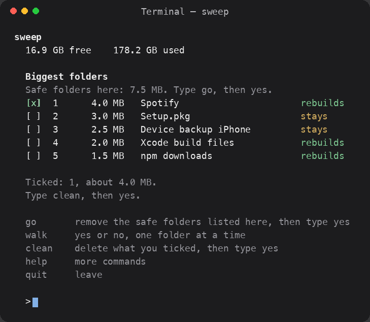

# sweep

A quiet disk cleaner for macOS. Open it, type a number, tick the folders you want, then type `yes`. Nothing is deleted before that.



Paid cleaner apps charge you to empty caches, then sell a subscription on top. sweep is one command, the list of paths is in the source, and it does not free RAM, scan for viruses, or phone home.

## Install

From Terminal:

```bash
brew tap kprobe0/sweep https://github.com/kprobe0/sweep
brew install --HEAD kprobe0/sweep/sweep
```

Or paste this and press Return:

```bash
curl -fsSL https://raw.githubusercontent.com/kprobe0/sweep/main/install.sh | bash
```

If it says to add a PATH line, paste that too. Then type:

```bash
sweep
```

You can also install from a clone:

```bash
git clone https://github.com/kprobe0/sweep.git
cd sweep
make install
```

## The menu

`sweep` opens on the biggest folders, largest first, with plain names (Spotify, not a bundle id). `rebuilds` means the app or tool creates it again. `stays` means the space stays gone, which is why backups and old installers are not part of `go`. `ask first` and `app open` mean look before you delete.

- Type `1` or `1 3` to tick lines. Type `Spotify` to tick that line.
- Type `more` for the next page, and `find music` to show only matching names.
- Type `clean`, then type `yes`, to delete what you ticked.
- Press Return instead of `yes` to cancel.
- Type `caches`, `trash`, `dev`, or `backups` to open just that list.
- Type `groups` for the short list of those names.
- Type `safe`, then `yes`, to clear the usual caches and leave backups alone.
- Type `go`, then `yes`, to remove the safe folders on the list. Folders under 1 MB stay hidden until you type `small`.
- Type `walk` to go one safe folder at a time. `yes` deletes it, `no` keeps it, `quit` stops.
- Type `help` if you want the rest of the commands, and `quit` to leave.
- Type `info 1` to see the real folder for a line. Type `last` to see what was already removed.
- Type `downloads` for installer files, `login` for helpers whose program is already gone, and `uninstall Name` to preview one app. The app goes to the Trash only after `--yes`. Leftovers stay unless you pass `--leftovers`.

## Commands

```bash
sweep
sweep items caches
sweep clean caches --only "Google/AndroidStudio" --yes
sweep scan
sweep large
```

`sweep clean --yes` covers caches the system or the tool will rebuild: user caches, Homebrew, npm and the other dev caches, Xcode DerivedData, a few app caches, old logs, Quick Look thumbnails, and the Trash.

These stay put unless you name them:

| Group | What it removes |
| --- | --- |
| `browsers` | Safari, Chrome, Firefox, Brave, Arc, Edge, Opera caches |
| `archives` | Xcode archives |
| `devices` | iOS, watch, tv, and vision device-support files |
| `simulators` | Simulators whose runtime is no longer installed |
| `docker` | Stopped containers, dangling images, unused networks |
| `backups` | iPhone and iPad backups. This cannot be undone |
| `projects` | `node_modules` next to a `package.json`, Cargo `target`, Swift `.build`, `__pycache__` |

CloudKit, HomeKit, and Family Sharing caches are left alone. Documents, Desktop, Photos, Music, Movies, Mail, Messages, Preferences, and `~/.ssh` are never deleted. Crash reports in DiagnosticReports are kept.

Quit a browser before `sweep clean browsers --yes`. That clears the page cache. Cookies live somewhere else and stay put.

## Why the first run can sit there

Measuring `~/Library/Caches` means reading the size of every folder in it. That is the slow part. The delete, once you ask for it, is the fast part.
